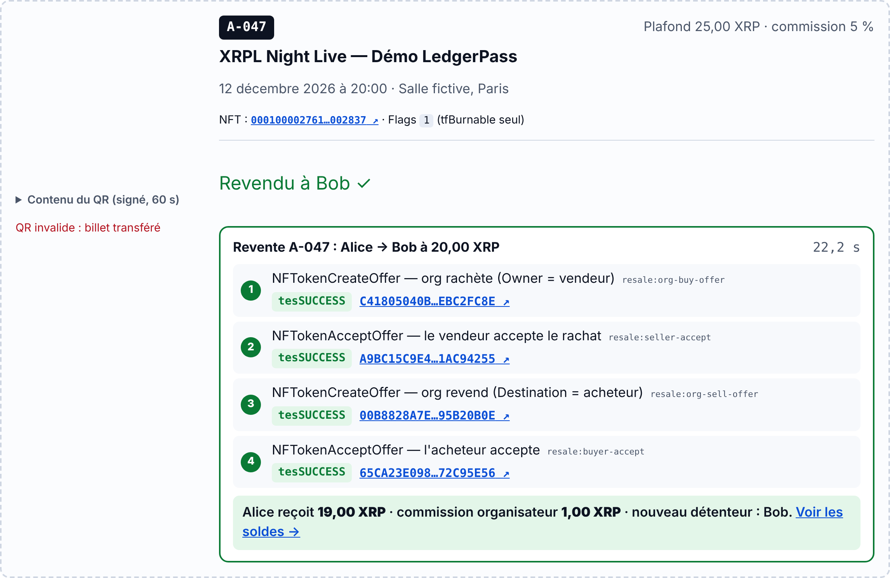
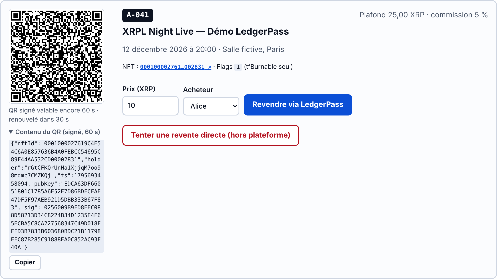
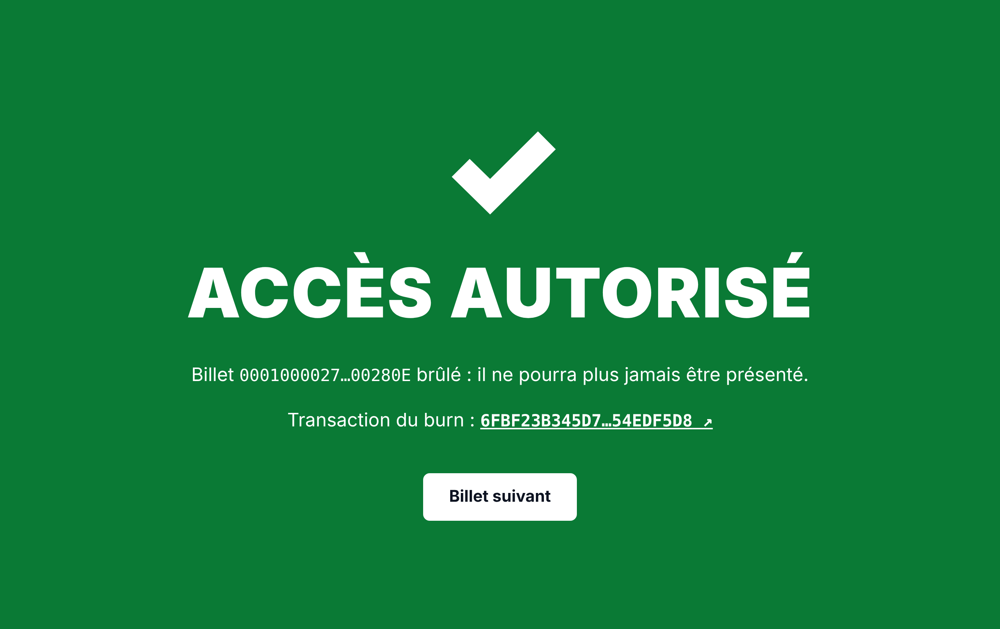
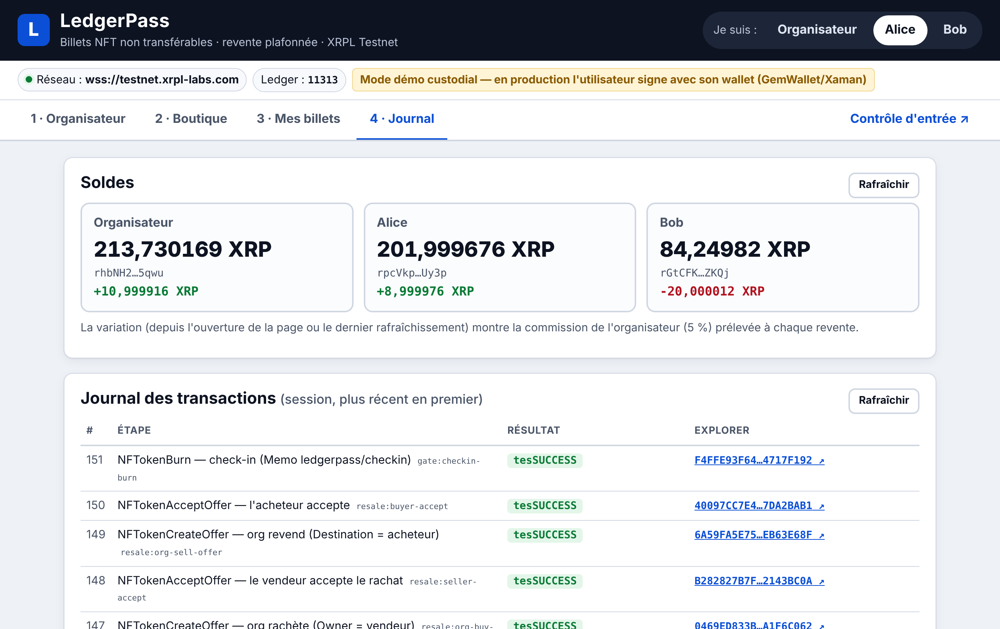

# LedgerPass — billetterie NFT anti-fraude sur XRPL Testnet

**Chaque billet est un NFT XRPL non transférable : impossible de le revendre au marché noir, le protocole le refuse.**
**La revente passe obligatoirement par l'organisateur, à un prix plafonné (25 XRP) avec une commission de 5 %.**
**À l'entrée, le scan brûle le NFT on-chain : un billet ne sert qu'une fois, et tout est vérifiable sur l'explorateur public.**

Hackathon XRPL — ING5 CReATE, novembre 2026. PoC **Testnet uniquement**.


---

## Sommaire

1. [Problème et pourquoi XRPL](#1-problème-et-pourquoi-xrpl)
2. [Le modèle retenu : option B](#2-le-modèle-retenu--option-b)
3. [Architecture](#3-architecture)
4. [Prérequis](#4-prérequis)
5. [Installation](#5-installation)
6. [Réseau utilisé](#6-réseau-utilisé)
7. [Adresses de test](#7-adresses-de-test)
8. [Lancement](#8-lancement)
9. [Scénario de démo pas à pas](#9-scénario-de-démo-pas-à-pas)
10. [Recréer les comptes après un reset du Testnet](#10-recréer-les-comptes-après-un-reset-du-testnet)
11. [Tests](#11-tests)
12. [Sécurité](#12-sécurité)
13. [Limites](#13-limites)
14. [Structure du dépôt](#14-structure-du-dépôt)
15. [Équipe](#15-équipe)

---

## 1. Problème et pourquoi XRPL

**Problème.** Billets falsifiés ou vendus plusieurs fois, revente spéculative à des prix délirants, aucune traçabilité : l'acheteur d'occasion n'a aucun moyen de savoir si son billet est authentique et pas déjà utilisé.

**Pourquoi XRPL.**
- **NFT natifs** (XLS-20) : mint, offres, transfert et burn sont des transactions du protocole. Il n'y a aucun smart contract à écrire ni à auditer.
- **Le flag `tfTransferable`** permet de rendre un NFT non transférable entre tiers : c'est le ledger, pas notre application, qui bloque le marché noir.
- **Finalité en 3 à 5 s** et frais de l'ordre de 0,00001 XRP : compatible avec une file d'entrée.
- **Lecture publique** (`account_nfts`, [testnet.xrpl.org](https://testnet.xrpl.org)) : n'importe qui vérifie l'état d'un billet.

**Briques XRPL retenues** : NFT XLS-20 (`NFTokenMint` / `NFTokenCreateOffer` / `NFTokenAcceptOffer` / `NFTokenBurn`), offres avec `Destination`, Memos (preuve sha256 des métadonnées, trace du check-in), `account_nfts` pour relire l'état. **Écartées** : royalty native `TransferFee` (voir § 2), smart contracts / Hooks (inutiles : le protocole porte déjà la règle), `nft_info` (Clio uniquement, non garanti sur tous les nœuds).

## 2. Le modèle retenu : option B

| Règle | Mise en œuvre XRPL |
|---|---|
| Billet = NFT | `NFTokenMint` avec `Flags = tfBurnable` (1), **sans** `tfTransferable`, `NFTokenTaxon` = id de l'événement, Memo `ledgerpass/mint` contenant le sha256 des métadonnées |
| Vente primaire (10 XRP) | l'organisateur crée une offre de vente avec `Destination = acheteur`, l'acheteur l'accepte |
| Revente directe Alice → Bob | **refusée par le protocole** : `tefNFTOKEN_IS_NOT_TRANSFERABLE` (sans `tfTransferable`, seul l'émetteur peut créer une offre) |
| Revente encadrée (≤ 25 XRP) | 1) l'org crée une offre d'**achat** à `prix × 0,95` (`Owner = vendeur`), le vendeur accepte ; 2) l'org crée une offre de **vente** à `prix` (`Destination = acheteur`), l'acheteur accepte. L'org garde 5 %. |
| Prix > plafond | refusé par l'API (HTTP 400) avant toute transaction : comme l'org est le seul à pouvoir créer une offre, le plafond est applicable |
| Contrôle d'entrée | `NFTokenBurn` signé par l'org avec `Owner = détenteur` + Memo `ledgerpass/checkin`. Accès accordé **uniquement** si le burn est `tesSUCCESS` ; un rescan est donc refusé |

Pourquoi pas de royalty native (`TransferFee`) : elle exige `tfTransferable`, ce qui rouvrirait le marché noir, et elle se contourne par une vente à 0 XRP. Le plafond, appliqué par le seul acteur capable de créer une offre (l'organisateur), est donc plus robuste qu'une royalty.

## 3. Architecture

```
Front web (Vite, aucune seed) ──HTTP /api──► API Node.js/Express (xrpl.js, services/) ──tx signées──► XRPL Testnet
                                                    │                                                  │
                                         off-chain : catalogue, plafond,                     explorateur public
                                         metadata/*.json, data/db.json (journal)             testnet.xrpl.org
```

Le script e2e (`scripts/e2e-demo.js`) appelle **la même couche `server/src/services/`** que l'API.

**Qui signe quoi** (mode démo custodial : seul le backend signe, le front n'a aucune seed) :

| Action | Transactions | Signataire |
|---|---|---|
| Mint | `NFTokenMint` (Flags 1, Taxon = événement, URI, Memo sha256) | org |
| Vente primaire | `NFTokenCreateOffer` vente, `Destination` = acheteur → `NFTokenAcceptOffer` | org → acheteur |
| Revente encadrée | offre d'achat org (`Owner` = vendeur) → accept vendeur → offre de vente org (`Destination` = acheteur) → accept acheteur | org, vendeur, org, acheteur |
| Revente directe (preuve) | `NFTokenCreateOffer` par le détenteur → rejet `tefNFTOKEN_IS_NOT_TRANSFERABLE` | détenteur |
| QR du billet | signature hors chaîne (`ledgerpass\|nftId\|holder\|ts`) avec la clé du détenteur, valable 60 s | détenteur |
| Contrôle d'entrée | `NFTokenBurn` (`Owner` = détenteur) + Memo `ledgerpass/checkin` | org |

**Routes de l'API** (`http://127.0.0.1:3000/api`, JSON ; erreur = `{ error, code, hash? }`) :

| Route | Rôle |
|---|---|
| `GET /health` | nœud XRPL, ledger, adresses publiques ; répond immédiatement (`network: null`, `status: "connecting"` pendant une reconnexion) |
| `GET /events`, `GET /balances`, `GET /tx` | catalogue, soldes, journal des transactions de la session |
| `POST /admin/mint` (`X-Admin-Token`) | `{ eventId, count ≤ 10 }` → billets mintés + tx |
| `POST /primary/buy` | `{ nftId, buyer }` → vente primaire (2 tx) |
| `GET /wallets/:who/tickets` | billets détenus (relus via `account_nfts` ; la Boutique exclut ceux en cours d'opération et ceux « en suspens » après une revente interrompue) |
| `GET /wallets/:who/tickets/:nftId/qr` | QR signé `{ nftId, holder, ts, pubKey, sig }` (404 si `who` ne détient pas le billet, 400 si `who = org`) |
| `GET /tickets/:nftId` | statut relu on-chain (`owner`, `burned`, historique, `pendingResale` éventuel) ; 404 si inconnu |
| `POST /resale` | `{ nftId, seller, buyer, priceXrp }` (1 ≤ prix ≤ plafond) → 4 tx ; en cas d'échec partiel : `stage`, `txs`, `currentOwner` relu on-chain |
| `POST /resale/direct` | tentative de revente directe : sur un billet détenu, 409 `tefNFTOKEN_IS_NOT_TRANSFERABLE` (400 si la requête est invalide : `nftId`, acteurs, prix) |
| `POST /gate/checkin` (`X-Gate-Token`) | contenu du QR signé + `eventId` (défaut 1) → `{ granted: true, tx }` ou 409 `{ granted: false, reason }` ; 504 `TX_UNKNOWN` + `hash` si la validation du burn n'a pas pu être constatée (réseau) |

| On-chain (XRPL) | Off-chain (serveur) |
|---|---|
| Existence et identifiant du billet (`NFTokenID`) | Catalogue des événements (nom, date, lieu, prix) |
| Propriétaire actuel (relu via `account_nfts`) | Plafond de revente (25 XRP) et commission (5 %) |
| Flags (`tfBurnable`, non transférable), Taxon = événement, URI | Métadonnées JSON (`metadata/evt-<id>/<place>.json`) |
| Offres de vente et d'achat, acceptations (paiements XRP) | Alias de démo `org` / `alice` / `bob` ↔ adresses |
| Burn à l'entrée + Memo `ledgerpass/checkin` | Journal des hash de la session (`/api/tx`) |
| sha256 des métadonnées dans le Memo du mint | Lien personne ↔ adresse (en cible, jamais on-chain) |

Le statut d'un billet (propriétaire, brûlé ou non) n'est **jamais stocké** côté serveur : il est toujours relu on-chain.

## 4. Prérequis

- **Node.js ≥ 20** (testé avec Node 22) et npm
- **Git**
- Un accès réseau à au moins un nœud WebSocket du Testnet (voir [§ 6](#6-réseau-utilisé)) et au faucet `faucet.altnet.rippletest.net` (création des comptes uniquement)
- Optionnel : une webcam sur le poste de démo pour scanner les QR (sinon, saisie manuelle). **Le téléphone n'est pas supporté sans HTTPS** : depuis une IP du réseau local, le navigateur refuse la caméra (voir [§ 8](#8-lancement))

## 5. Installation

```bash
git clone https://github.com/ninoatns/LedgerPass.git
cd LedgerPass
npm ci                    # dépendances aux versions figées (package-lock.json)
cp .env.example .env      # (facultatif : npm run setup le crée s'il manque)
npm run setup             # jetons aléatoires + 3 comptes Testnet financés, seeds écrites dans .env
npm run check             # (optionnel) teste chaque nœud XRPL configuré
```

`npm run setup` :
- génère des `ADMIN_TOKEN` / `GATE_TOKEN` aléatoires (`crypto.randomBytes`) s'ils sont vides ou à une valeur d'exemple (`npm run setup -- --tokens-only` ne fait que cela) ; pour les saisir dans l'interface, ouvrez `.env` **hors projection** (écran non partagé, avant la soutenance) : n'affichez jamais `.env` sur l'écran projeté ;
- génère les comptes `org`, `alice`, `bob` s'ils n'existent pas dans `.env`, et les finance via le faucet (≈ 100 XRP chacun) ;
- réutilise les comptes existants (aucun appel faucet inutile) ;
- n'affiche **jamais** les seeds : seules les adresses publiques sont imprimées et écrites dans [`docs/accounts.md`](docs/accounts.md).

Variables de `.env` :

| Variable | Rôle |
|---|---|
| `XRPL_WS_URLS` | nœuds WebSocket, essayés dans l'ordre (fallback) |
| `ORG_SEED`, `ALICE_SEED`, `BOB_SEED` | seeds **Testnet**, remplies par `npm run setup` |
| `ADMIN_TOKEN` | jeton `X-Admin-Token` exigé pour minter (onglet Organisateur) |
| `GATE_TOKEN` | jeton `X-Gate-Token` exigé pour le contrôle d'entrée (`scan.html`) |
| `PORT` | port de l'API (3000 par défaut) |
| `HOST` | interface d'écoute de l'API (`127.0.0.1` par défaut : non exposée sur le réseau local) |
| `CORS_ORIGINS` | origines autorisées (défaut `http://localhost:5173,http://127.0.0.1:5173`) |
| `PUBLIC_BASE_URL` | base des URI de métadonnées inscrites au mint : `https://raw.githubusercontent.com/ninoatns/LedgerPass/main` (dépôt public) ; vide → `http://localhost:3000` |

Le serveur **refuse de démarrer** si un jeton est vide, vaut `change-me…` ou fait moins de 16 caractères.

**Métadonnées.** `metadata/evt-1/A-001.json` … `A-300.json` sont pré-générées et committées : l'URI du NFT (`<PUBLIC_BASE_URL>/metadata/evt-1/A-xxx.json`, 84 octets ≤ 256) se résout publiquement sur GitHub une fois le dépôt poussé. L'API sert aussi `/metadata` en local pour le front. Le compteur de sièges est local (`data/db.json`) et repart à A-001 sur une nouvelle installation ; au-delà de A-300, les métadonnées sont générées localement dans `data/generated-metadata/` (non commité, avertissement dans les logs) et leur URI GitHub renvoie 404. Pour pré-générer davantage de sièges : `npm run gen:metadata -- --count N` (idempotent, ne réécrit jamais un fichier existant), puis commit + push. L'intégrité ne dépend pas de l'hébergement : le sha256 du fichier est inscrit dans le Memo `ledgerpass/mint`.

## 6. Réseau utilisé

- **XRPL Testnet** uniquement (aucune seed Mainnet, nulle part).
- Nœuds, essayés dans l'ordre de `XRPL_WS_URLS` :
  - `wss://testnet.xrpl-labs.com` (XRPL Labs, port 443 : passe les pare-feux ; en premier par défaut)
  - `wss://s.altnet.rippletest.net:51233` (nœud public Ripple ; le port 51233 est bloqué sur certains Wi-Fi, dont celui de l'école)
  - `wss://testnet.honeycluster.io`
- **Fallback automatique** : si un nœud ne répond pas dans le délai, on passe au suivant.
- **Rejet des nœuds désynchronisés** : à la connexion, le client lit `server_info` et **refuse un nœud dont le dernier ledger validé a plus de 60 s**. C'est le cas observé de `testnet.honeycluster.io`, resté figé sur un ancien Testnet (dernier ledger validé il y a plus de 10 h) : sans ce contrôle, l'application aurait lu un état faux.
- **Garde-fou Testnet** : un nœud dont `server_info.network_id` ≠ 1 est rejeté (s'il ne renvoie pas ce champ : simple avertissement dans les logs).
- Le nœud réellement utilisé est affiché dans le bandeau de l'interface et par `GET /api/health`.
- Derrière un proxy d'entreprise : définir `HTTPS_PROXY` (et `NODE_EXTRA_CA_CERTS` si besoin), le client passe alors par `https-proxy-agent`.

Exemple de `npm run check` :

```
OK   wss://testnet.xrpl-labs.com  1242 ms  ledger=10621  version=3.4.1
FAIL wss://s.altnet.rippletest.net:51233  read ECONNRESET
FAIL wss://testnet.honeycluster.io  noeud désynchronisé (dernier ledger validé il y a 36111 s, état full)
```

## 7. Adresses de test

Adresses **publiques** des comptes de démo (seeds dans `.env`, jamais commitées). Liste à jour, régénérée par `npm run setup` : [`docs/accounts.md`](docs/accounts.md).

| Rôle | Adresse | Explorer |
|---|---|---|
| Organisateur (`org`, émetteur des billets) | `rhbNH2oD69dnQ6jebAmqkuTezt1YNa5qwu` | [voir](https://testnet.xrpl.org/accounts/rhbNH2oD69dnQ6jebAmqkuTezt1YNa5qwu) |
| Alice (acheteuse puis revendeuse) | `rpcVkpNjwZ5UXpPnwtJufvDoe7cjrVUy3p` | [voir](https://testnet.xrpl.org/accounts/rpcVkpNjwZ5UXpPnwtJufvDoe7cjrVUy3p) |
| Bob (acheteur de la revente) | `rGtCFKQrUnHa1XjjqM7oo98mdmc7CMZKQj` | [voir](https://testnet.xrpl.org/accounts/rGtCFKQrUnHa1XjjqM7oo98mdmc7CMZKQj) |

> Le Testnet peut être réinitialisé : si ces liens renvoient « compte introuvable », suivez le [§ 10](#10-recréer-les-comptes-après-un-reset-du-testnet).

## 8. Lancement

Deux terminaux, à la racine du dépôt :

```bash
npm run dev        # API  → http://127.0.0.1:3000/api   (écoute locale uniquement ; ex. /api/health)
npm run dev:web    # Front → http://localhost:5173       (Vite, proxifie /api et /metadata vers 127.0.0.1:3000)
```

| URL | Usage |
|---|---|
| http://localhost:5173/ | billetterie : onglets **1 · Organisateur**, **2 · Boutique**, **3 · Mes billets**, **4 · Journal** ; sélecteur « Je suis : Organisateur / Alice / Bob » en haut à droite |
| http://localhost:5173/scan.html | **contrôle d'entrée** : scan caméra du QR, ou saisie manuelle du JSON du QR |
| http://127.0.0.1:3000/api/health | état du backend : nœud XRPL, ledger courant, adresses |

**Jetons.** L'onglet Organisateur demande le jeton admin (`ADMIN_TOKEN` de `.env`) ; `scan.html` demande le jeton de contrôle (`GATE_TOKEN`). Ils sont saisis dans des champs masqués et gardés en `sessionStorage` (effacés à la fermeture de l'onglet). Le front ne détient **aucune seed**.

**Caméra et téléphone.** Le navigateur n'autorise la caméra qu'en HTTPS ou sur `localhost`. **Un téléphone n'est donc pas supporté** en l'état : `npm run dev:web -- --host` rend bien le front joignable depuis le réseau local, mais en HTTP sur une IP, la caméra y est refusée (il faudrait un certificat HTTPS, non fourni). Attention : `--host` expose aussi, via le proxy Vite, les routes non authentifiées de l'API au réseau local (voir [§ 12](#12-sécurité)) ; ne l'utilisez pas sur un Wi-Fi partagé. **Démo retenue** : sur le poste de démo, « Mes billets » → « Contenu du QR » → bouton **Copier**, puis collage dans `scan.html` (saisie manuelle) et validation **en moins de 60 s**.

**Mode simulé.** `http://localhost:5173/?mock=1` rejoue l'interface sans backend ni Testnet (données marquées « DONNÉES SIMULÉES »). Il ne s'active **que** par `?mock=1` : si l'API est injoignable, la billetterie et `scan.html` affichent un **écran d'erreur bloquant** (bouton « Réessayer »), jamais de données simulées à l'insu du public. Si XRPL est en reconnexion, le bandeau l'indique (« XRPL en reconnexion »). **Pour la vraie démo, vérifiez que le bandeau affiche le nœud `wss://…` et aucun badge « mock ».**

**QR signé.** Dans « Mes billets », le QR contient `{ nftId, holder, ts, pubKey, sig }` : le backend signe `ledgerpass|nftId|holder|ts` avec la clé du détenteur (custodial). Le QR est régénéré toutes les 30 s (compte à rebours affiché ; en cas d'échec passager, l'ancien QR reste affiché tant qu'il est valable et un nouvel essai est fait 5 s plus tard) ; le contrôle vérifie la signature, que `pubKey` correspond bien au porteur, que le QR a moins de 60 s et qu'il n'est pas daté de plus de 5 s dans le futur. Une capture d'écran ne sert donc qu'une minute, et un QR inventé ou modifié est refusé.

**Ne lancez pas `npm run e2e` pendant une démo dans l'interface** : le script utilise les mêmes comptes que le serveur (il affiche un avertissement s'il détecte l'API en cours).

Build statique optionnel : `npm run build:web` (sortie dans `web/dist/`).

## 9. Scénario de démo pas à pas

Durée réelle : ≈ 4 s par transaction, ≈ 2 min pour tout le scénario.

| # | Où | Action | Résultat attendu |
|---|---|---|---|
| 1 | Onglet **1 · Organisateur** | Saisir le jeton admin, nombre = 3, **Minter les billets** | 3 × `NFTokenMint` `tesSUCCESS`, NFTokenID + sha256 des métadonnées, stock on-chain de l'org mis à jour |
| 2 | « Je suis : **Alice** », onglet **2 · Boutique** | **Acheter en tant qu'Alice** sur un billet | 2 tx : offre de vente de l'org (`Destination` = Alice) puis acceptation par Alice ; 10 XRP payés |
| 3 | Onglet **3 · Mes billets** (Alice) | **Tenter une revente directe (hors plateforme)** | Bandeau rouge **« Refusé par le protocole XRPL — `tefNFTOKEN_IS_NOT_TRANSFERABLE` »** (rejet avant ledger, aucun frais) |
| 4 | Même carte | Prix **20**, acheteur Bob, **Revendre via LedgerPass** | 4 tx `tesSUCCESS` : rachat par l'org (19 XRP), acceptation d'Alice, offre de vente à Bob (20 XRP), acceptation de Bob. « Alice reçoit 19,00 XRP · commission organisateur 1,00 XRP » |
| 5 | « Je suis : **Bob** », **Mes billets** | Sur le billet racheté : prix **30**, acheteur Alice, **Revendre via LedgerPass** | Avertissement puis refus : « prix 30 XRP supérieur au plafond 25 XRP » (HTTP 400, aucune transaction ; Bob garde le billet) |
| 6 | Même carte (Bob) | Le QR signé s'affiche (compte à rebours « valable encore … s ») ; « Contenu du QR » → **Copier** | QR signé = `{"nftId":"…","holder":"r…","ts":…,"pubKey":"…","sig":"…"}` |
| 7 | **Contrôle d'entrée ↗** (`scan.html`, même poste) | Jeton de contrôle, **coller** le JSON copié dans la saisie manuelle, **Valider l'entrée** — **moins de 60 s** après la copie | Écran vert **ACCÈS AUTORISÉ** + lien du `NFTokenBurn` (QR expiré, daté dans le futur, forgé, non signé, porteur = organisateur ou billet d'un autre événement : **REFUSÉ** avec le motif ; réseau coupé pendant le burn : écran orange **STATUT INCONNU** avec le hash à vérifier) |
| 8 | Même page | **Billet suivant**, revalider le même QR | Écran rouge **REFUSÉ — billet déjà utilisé (brûlé)** |
| 9 | Onglet **4 · Journal** | Lire les soldes et le journal | Variation des soldes (org +11 : 10 de vente primaire + 1 de commission ; Alice +9 ; Bob −20) et tous les hash cliquables vers testnet.xrpl.org |

Captures de ce scénario exécuté sur le Testnet : [`docs/screenshots/`](docs/screenshots/).

| Mint | Revente directe refusée | Revente encadrée |
|---|---|---|
|  |  |  |

| QR signé de Bob | Contrôle d'entrée | Journal et soldes |
|---|---|---|
|  |  |  |

**Plan B (sans navigateur).** Le même scénario, en ligne de commande, avec pause avant chaque étape (à lancer dans un vrai terminal) :

```bash
npm run e2e -- --step     # Entrée pour lancer chaque étape
npm run e2e               # tout d'un coup
```

Chaque exécution écrit les hash, liens explorer, le NFTokenID et le siège du billet suivi dans [`demo/last-run.md`](demo/last-run.md) : ce fichier et les captures ci-dessus servent de preuve si le réseau tombe pendant la soutenance (liens vers des transactions déjà confirmées sur testnet.xrpl.org). Si un compte manque de XRP, le script le recharge automatiquement au faucet.

## 10. Recréer les comptes après un reset du Testnet

Le Testnet est réinitialisé périodiquement : comptes, NFT et historique disparaissent.

```bash
npm run setup               # adresses de .env absentes du ledger → elles sont refinancées au faucet (mêmes adresses)
npm run setup -- --force    # OU : régénère 3 nouveaux comptes (nouvelles seeds écrites dans .env)
npm run e2e                 # vérifie que tout refonctionne et régénère demo/last-run.md
```

`--force` réécrit `docs/accounts.md` avec les nouvelles adresses : pensez à mettre à jour le tableau du [§ 7](#7-adresses-de-test). Après un reset, supprimez aussi `data/db.json` (journal et sièges de l'ancien réseau) : il est recréé depuis `data/db.sample.json` au démarrage. `npm run cleanup` annule les offres NFT orphelines et libère leur réserve (0,2 XRP par offre).

## 11. Tests

```bash
npm test          # 23 tests unitaires (node:test), sans réseau : XRP/drops, commission et plafond, Memos/URI/flags, offerId/NFTokenID, QR signé (valide, expiré, daté dans le futur, forgé, mauvais porteur, non signé), jetons (temps constant, jetons faibles), attente de validation bornée (TX_UNKNOWN)
npm run e2e       # test d'intégration réel sur le Testnet : 9 étapes, assertions sur les résultats et les soldes, code de sortie ≠ 0 en cas d'échec
```

Le scénario complet a aussi été joué dans le navigateur (Playwright) contre le vrai backend et le Testnet, dans le même ordre que l'e2e : mint ×3, achat par Alice, revente directe refusée (`tefNFTOKEN_IS_NOT_TRANSFERABLE`), revente encadrée à 20 XRP, tentative de Bob à 30 XRP refusée (plafond), QR signé de Bob copié puis collé dans `scan.html` → accès autorisé, rescan refusé, journal et soldes. L'e2e vérifie aussi les refus du contrôle d'entrée sans transaction : QR non signé, expiré, daté dans le futur, forgé, signé par un autre que le porteur, mauvais détenteur, porteur = organisateur (billet invendu), billet d'un autre événement.

## 12. Sécurité

- **Testnet uniquement.** Aucune seed Mainnet, nulle part.
- **Secrets hors Git.** Les seeds et jetons sont dans `.env` (permissions 600, listé dans `.gitignore`) ; `.env.example` ne contient aucune valeur sensible. Les scripts n'affichent jamais une seed, seulement des adresses publiques.
- **Mode démo custodial, assumé.** Le backend détient les seeds Testnet de `org`, `alice` et `bob` et signe pour eux, pour une démo fiable en 5 minutes. Le front n'a aucune seed ; le bandeau de l'interface le rappelle en permanence. En production, chaque acheteur signe lui-même son `NFTokenAcceptOffer` avec son wallet (Xaman, GemWallet) et seul l'organisateur garde une clé serveur.
- **Routes sensibles protégées** : mint par `X-Admin-Token`, contrôle d'entrée par `X-Gate-Token` ; jetons aléatoires générés par `npm run setup`, comparés à temps constant (`crypto.timingSafeEqual`) ; le serveur refuse de démarrer avec un jeton vide ou d'exemple.
- **Exposition réseau minimale** : API sur `127.0.0.1` uniquement (`HOST`), CORS limité au front Vite (`CORS_ORIGINS`).
- **Routes de vente et de QR non authentifiées (custodial)** : `POST /primary/buy`, `POST /resale`, `POST /resale/direct` et `GET /wallets/:who/tickets/:nftId/qr` signent pour Alice ou Bob **sans authentification** ; elles ne sont protégées que par l'écoute locale (`127.0.0.1`). Quiconque atteint l'API peut donc acheter, revendre ou obtenir un QR valide au nom d'un acteur de démo. Ne jamais exposer l'API (ni le front lancé avec `--host`, qui la proxifie) sur un réseau partagé. **En cible**, ces signatures viennent du wallet de l'utilisateur (Xaman, GemWallet) et ces routes disparaissent : le serveur ne garde que les actions de l'organisateur.
- **Contrôle d'entrée non falsifiable par le QR** : QR signé par le détenteur, valable 60 s, refusé s'il est daté de plus de 5 s dans le futur, `pubKey` → adresse = porteur ; refus si le porteur est l'organisateur (billet invendu) ou si le billet n'est pas de l'événement contrôlé ; l'accès n'est accordé que si le `NFTokenBurn` est `tesSUCCESS`.
- **Une opération à la fois par billet** : verrou partagé (vente, revente, contrôle), libéré dans tous les cas (succès, refus, erreur) ; un billet en cours d'opération n'apparaît pas dans la Boutique.
- **Attente de validation bornée** : au-delà de ≈ 90 s sans pouvoir constater la validation (coupure réseau), la transaction est déclarée `TX_UNKNOWN` avec son hash ; le contrôle d'entrée affiche alors **« statut inconnu — vérifiez le hash »** (écran orange), jamais « ACCÈS AUTORISÉ » ni « REFUSÉ » à tort.
- **Aucune donnée personnelle on-chain** : acteurs fictifs, métadonnées sans nom ; seul un sha256 des métadonnées est inscrit dans le Memo.

**Cible production** : chaque utilisateur signe ses `NFTokenAcceptOffer` et son QR avec son propre wallet ; l'organisateur garde une seule clé serveur (idéalement un compte `NFTokenMinter` dédié, séparé du compte qui encaisse).

## 13. Limites

- **Revente non atomique** (4 tx) : en cas d'échec au milieu, le billet peut rester chez l'organisateur avec le vendeur déjà payé. L'API relit alors le détenteur on-chain et renvoie l'étape, les tx passées et le détenteur actuel. Le billet est marqué **« en suspens »** dans `data/db.json` (`tickets[<nftId>].pendingResale` : étape, vendeur, acheteur, prix, hash) : il **n'est plus proposé dans la Boutique** et la vente primaire le refuse (409 `PENDING_RESALE`), pour ne pas le revendre une seconde fois. La reprise est manuelle (rembourser le vendeur ou relancer la vente à l'acheteur, puis retirer `pendingResale` du fichier) et tracée dans le Journal.
- **Routes custodiales non authentifiées** : vente, revente et QR signent pour Alice/Bob sans authentification, protégés seulement par l'écoute locale (voir [§ 12](#12-sécurité)) ; en cible, ces signatures viennent du wallet de l'utilisateur et ces routes disparaissent.
- **Pas de téléphone en démo** : sans HTTPS, la caméra est refusée hors `localhost` ; le QR est copié puis collé dans `scan.html` sur le même poste.
- **Custodial en démo** : le backend détient les seeds de tous les acteurs et signe pour eux (y compris le QR) ; en production, chaque utilisateur signe avec son wallet.
- **Pouvoir de l'organisateur** : il peut brûler tout billet `tfBurnable` et fixe seul le plafond ; c'est le tiers de confiance assumé du modèle (actions visibles on-chain).
- **QR** : signé et valable 60 s, mais une capture partagée dans la minute reste utilisable une fois (le premier scan brûle le billet).
- **Contrôle d'entrée en ligne** : il faut joindre le Testnet pour brûler le billet (≈ 4 s par entrée).
- **Métadonnées hors chaîne** (GitHub / serveur) : seul leur sha256 est on-chain ; 300 fichiers pré-générés (A-001…A-300).
- **Verrous en mémoire** d'un seul processus API ; ne pas lancer l'e2e en même temps que la démo (mêmes comptes).

## 14. Structure du dépôt

```
LedgerPass/
├── server/src/
│   ├── index.js, config.js, store.js   API Express, configuration (.env), stockage off-chain data/db.json
│   ├── xrpl/                           client (fallback + rejet nœud désynchronisé), soumission tx, wallets, faucet, Memos, montants
│   ├── security.js                     QR signé (signature/vérification), jetons (temps constant, jetons faibles)
│   ├── services/                       logique métier partagée API + e2e : mint, offers (vente primaire), resale, gate, query, locks
│   └── routes/                         routes HTTP du contrat d'API
├── scripts/
│   ├── setup-accounts.js               npm run setup   — création/financement des comptes
│   ├── check-network.js                npm run check   — test des nœuds
│   ├── e2e-demo.js                     npm run e2e     — scénario complet (test + plan B)
│   ├── cleanup-offers.js               npm run cleanup — annulation des offres orphelines
│   └── gen-metadata.js                 npm run gen:metadata — pré-génération des métadonnées (idempotent)
├── web/                                front Vite : index.html (billetterie), scan.html (contrôle d'entrée), src/
├── metadata/evt-1/A-001…A-300.json     métadonnées pré-générées (URI publique GitHub + servies sur /metadata)
├── data/db.sample.json                 base initiale (catalogue) ; db.json est local, non commité
├── test/                               tests unitaires (npm test)
├── demo/last-run.md                    hash de la dernière exécution e2e
└── docs/                               accounts.md (adresses publiques), screenshots/ (captures du scénario)
```

## 15. Équipe

- Lucien Simon
- Basile Lucas
- Aurore Monnet
- Nino Antunes

Projet réalisé dans le cadre du hackathon XRPL ING5 CReATE (25 → 27 novembre 2026).
