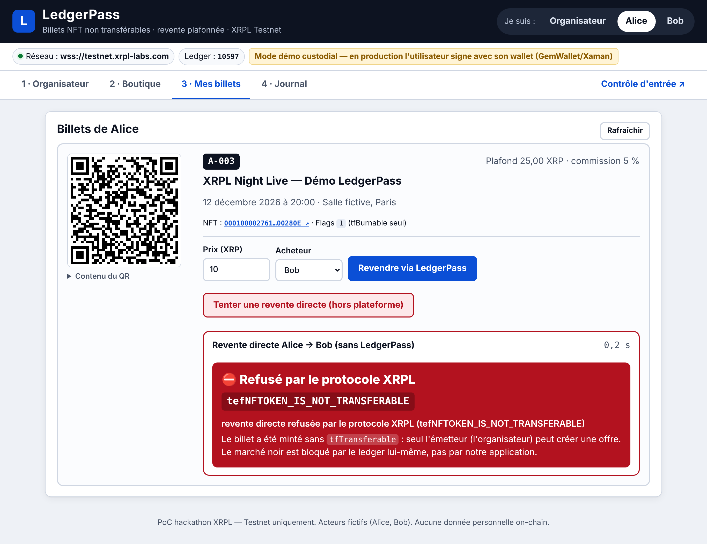
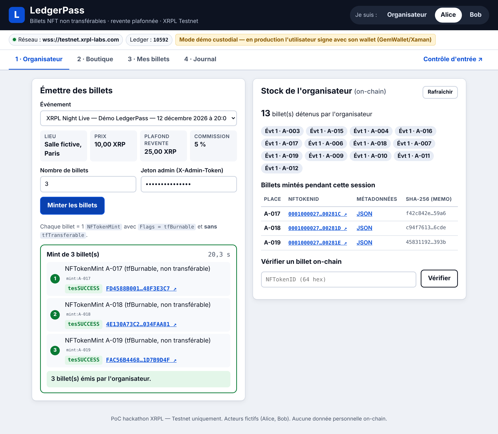

# LedgerPass — billetterie NFT anti-fraude sur XRPL Testnet

**Chaque billet est un NFT XRPL non transférable : impossible de le revendre au marché noir, le protocole le refuse.**
**La revente passe obligatoirement par l'organisateur, à un prix plafonné (25 XRP) avec une commission de 5 %.**
**À l'entrée, le scan brûle le NFT on-chain : un billet ne sert qu'une fois, et tout est vérifiable sur l'explorateur public.**

Hackathon XRPL — ING5 CReATE, novembre 2026. PoC **Testnet uniquement**.



---

## Sommaire

1. [Problème et pourquoi XRPL](#1-problème-et-pourquoi-xrpl)
2. [Le modèle retenu : option B](#2-le-modèle-retenu--option-b)
3. [Architecture](#3-architecture)
4. [Prérequis](#4-prérequis)
5. [Installation](#5-installation)
6. [Réseau utilisé](#6-réseau-utilisé)
7. [Adresses de test](#7-adresses-de-test)
8. [Lancement](#8-lancement)
9. [Scénario de démo pas à pas](#9-scénario-de-démo-pas-à-pas)
10. [Recréer les comptes après un reset du Testnet](#10-recréer-les-comptes-après-un-reset-du-testnet)
11. [Tests](#11-tests)
12. [Sécurité](#12-sécurité)
13. [Limites](#13-limites)
14. [Structure du dépôt](#14-structure-du-dépôt)
15. [Équipe](#15-équipe)

---

## 1. Problème et pourquoi XRPL

**Problème.** Billets falsifiés ou vendus plusieurs fois, revente spéculative à des prix délirants, aucune traçabilité : l'acheteur d'occasion n'a aucun moyen de savoir si son billet est authentique et pas déjà utilisé.

**Pourquoi XRPL.**
- **NFT natifs** (XLS-20) : mint, offres, transfert et burn sont des transactions du protocole. Il n'y a aucun smart contract à écrire ni à auditer.
- **Le flag `tfTransferable`** permet de rendre un NFT non transférable entre tiers : c'est le ledger, pas notre application, qui bloque le marché noir.
- **Finalité en 3 à 5 s** et frais de l'ordre de 0,00001 XRP : compatible avec une file d'entrée.
- **Lecture publique** (`account_nfts`, [testnet.xrpl.org](https://testnet.xrpl.org)) : n'importe qui vérifie l'état d'un billet.

Détail des briques retenues et des alternatives rejetées : [`docs/choix-xrpl.md`](docs/choix-xrpl.md).

## 2. Le modèle retenu : option B

| Règle | Mise en œuvre XRPL |
|---|---|
| Billet = NFT | `NFTokenMint` avec `Flags = tfBurnable` (1), **sans** `tfTransferable`, `NFTokenTaxon` = id de l'événement, Memo `ledgerpass/mint` contenant le sha256 des métadonnées |
| Vente primaire (10 XRP) | l'organisateur crée une offre de vente avec `Destination = acheteur`, l'acheteur l'accepte |
| Revente directe Alice → Bob | **refusée par le protocole** : `tefNFTOKEN_IS_NOT_TRANSFERABLE` (sans `tfTransferable`, seul l'émetteur peut créer une offre) |
| Revente encadrée (≤ 25 XRP) | 1) l'org crée une offre d'**achat** à `prix × 0,95` (`Owner = vendeur`), le vendeur accepte ; 2) l'org crée une offre de **vente** à `prix` (`Destination = acheteur`), l'acheteur accepte. L'org garde 5 %. |
| Prix > plafond | refusé par l'API (HTTP 400) avant toute transaction : comme l'org est le seul à pouvoir créer une offre, le plafond est applicable |
| Contrôle d'entrée | `NFTokenBurn` signé par l'org avec `Owner = détenteur` + Memo `ledgerpass/checkin`. Accès accordé **uniquement** si le burn est `tesSUCCESS` ; un rescan est donc refusé |

Pourquoi pas de royalty native (`TransferFee`) : elle exige `tfTransferable`, ce qui rouvrirait le marché noir, et elle se contourne par une vente à 0 XRP. Voir [`docs/choix-xrpl.md`](docs/choix-xrpl.md).

## 3. Architecture

```
Front web (Vite, aucune seed) ──HTTP /api──► API Node.js/Express (xrpl.js, services/) ──tx signées──► XRPL Testnet
                                                    │                                                  │
                                         off-chain : catalogue, plafond,                     explorateur public
                                         metadata/*.json, data/db.json (journal)             testnet.xrpl.org
```

Le script e2e (`scripts/e2e-demo.js`) appelle **la même couche `server/src/services/`** que l'API. Détail complet (qui signe quoi, cycle de vie, robustesse) : [`docs/architecture.md`](docs/architecture.md). Contrat d'API figé : [`docs/api-contract.md`](docs/api-contract.md).

| On-chain (XRPL) | Off-chain (serveur) |
|---|---|
| Existence et identifiant du billet (`NFTokenID`) | Catalogue des événements (nom, date, lieu, prix) |
| Propriétaire actuel (relu via `account_nfts`) | Plafond de revente (25 XRP) et commission (5 %) |
| Flags (`tfBurnable`, non transférable), Taxon = événement, URI | Métadonnées JSON (`metadata/evt-<id>/<place>.json`) |
| Offres de vente et d'achat, acceptations (paiements XRP) | Alias de démo `org` / `alice` / `bob` ↔ adresses |
| Burn à l'entrée + Memo `ledgerpass/checkin` | Journal des hash de la session (`/api/tx`) |
| sha256 des métadonnées dans le Memo du mint | Lien personne ↔ adresse (en cible, jamais on-chain) |

Le statut d'un billet (propriétaire, brûlé ou non) n'est **jamais stocké** côté serveur : il est toujours relu on-chain.

## 4. Prérequis

- **Node.js ≥ 20** (testé avec Node 22) et npm
- **Git**
- Un accès réseau à au moins un nœud WebSocket du Testnet (voir [§ 6](#6-réseau-utilisé)) et au faucet `faucet.altnet.rippletest.net` (création des comptes uniquement)
- Optionnel : un smartphone ou une webcam pour scanner les QR (sinon, saisie manuelle)

## 5. Installation

```bash
git clone https://github.com/ninoatns/LedgerPass.git
cd LedgerPass
npm ci                    # dépendances aux versions figées (package-lock.json)
cp .env.example .env      # puis remplacez ADMIN_TOKEN et GATE_TOKEN par vos propres valeurs
npm run setup             # crée et finance les 3 comptes Testnet, écrit leurs seeds dans .env
npm run check             # (optionnel) teste chaque nœud XRPL configuré
```

`npm run setup` :
- génère les comptes `org`, `alice`, `bob` s'ils n'existent pas dans `.env`, et les finance via le faucet (≈ 100 XRP chacun) ;
- réutilise les comptes existants (aucun appel faucet inutile) ;
- n'affiche **jamais** les seeds : seules les adresses publiques sont imprimées et écrites dans [`docs/accounts.md`](docs/accounts.md).

Variables de `.env` :

| Variable | Rôle |
|---|---|
| `XRPL_WS_URLS` | nœuds WebSocket, essayés dans l'ordre (fallback) |
| `ORG_SEED`, `ALICE_SEED`, `BOB_SEED` | seeds **Testnet**, remplies par `npm run setup` |
| `ADMIN_TOKEN` | jeton `X-Admin-Token` exigé pour minter (onglet Organisateur) |
| `GATE_TOKEN` | jeton `X-Gate-Token` exigé pour le contrôle d'entrée (`scan.html`) |
| `PORT` | port de l'API (3000 par défaut) |

## 6. Réseau utilisé

- **XRPL Testnet** uniquement (aucune seed Mainnet, nulle part).
- Nœuds, essayés dans l'ordre de `XRPL_WS_URLS` :
  - `wss://s.altnet.rippletest.net:51233` (nœud public Ripple ; le port 51233 est bloqué sur certains Wi-Fi, dont celui de l'école)
  - `wss://testnet.xrpl-labs.com` (XRPL Labs, port 443 : passe les pare-feux)
  - `wss://testnet.honeycluster.io`
- **Fallback automatique** : si un nœud ne répond pas dans le délai, on passe au suivant.
- **Rejet des nœuds désynchronisés** : à la connexion, le client lit `server_info` et **refuse un nœud dont le dernier ledger validé a plus de 60 s**. C'est le cas observé de `testnet.honeycluster.io`, resté figé sur un ancien Testnet (dernier ledger validé il y a plus de 10 h) : sans ce contrôle, l'application aurait lu un état faux.
- Le nœud réellement utilisé est affiché dans le bandeau de l'interface et par `GET /api/health`.
- Derrière un proxy d'entreprise : définir `HTTPS_PROXY` (et `NODE_EXTRA_CA_CERTS` si besoin), le client passe alors par `https-proxy-agent`.

Exemple de `npm run check` :

```
OK   wss://testnet.xrpl-labs.com  1242 ms  ledger=10621  version=3.4.1
FAIL wss://s.altnet.rippletest.net:51233  read ECONNRESET
FAIL wss://testnet.honeycluster.io  noeud désynchronisé (dernier ledger validé il y a 36111 s, état full)
```

## 7. Adresses de test

Adresses **publiques** des comptes de démo (seeds dans `.env`, jamais commitées). Liste à jour, régénérée par `npm run setup` : [`docs/accounts.md`](docs/accounts.md).

| Rôle | Adresse | Explorer |
|---|---|---|
| Organisateur (`org`, émetteur des billets) | `rhbNH2oD69dnQ6jebAmqkuTezt1YNa5qwu` | [voir](https://testnet.xrpl.org/accounts/rhbNH2oD69dnQ6jebAmqkuTezt1YNa5qwu) |
| Alice (acheteuse puis revendeuse) | `rpcVkpNjwZ5UXpPnwtJufvDoe7cjrVUy3p` | [voir](https://testnet.xrpl.org/accounts/rpcVkpNjwZ5UXpPnwtJufvDoe7cjrVUy3p) |
| Bob (acheteur de la revente) | `rGtCFKQrUnHa1XjjqM7oo98mdmc7CMZKQj` | [voir](https://testnet.xrpl.org/accounts/rGtCFKQrUnHa1XjjqM7oo98mdmc7CMZKQj) |

> Le Testnet peut être réinitialisé : si ces liens renvoient « compte introuvable », suivez le [§ 10](#10-recréer-les-comptes-après-un-reset-du-testnet).

## 8. Lancement

Deux terminaux, à la racine du dépôt :

```bash
npm run dev        # API  → http://localhost:3000/api   (ex. http://localhost:3000/api/health)
npm run dev:web    # Front → http://localhost:5173       (Vite, proxifie /api et /metadata vers :3000)
```

| URL | Usage |
|---|---|
| http://localhost:5173/ | billetterie : onglets **1 · Organisateur**, **2 · Boutique**, **3 · Mes billets**, **4 · Journal** ; sélecteur « Je suis : Organisateur / Alice / Bob » en haut à droite |
| http://localhost:5173/scan.html | **contrôle d'entrée** : scan caméra du QR, ou saisie manuelle du JSON du QR |
| http://localhost:3000/api/health | état du backend : nœud XRPL, ledger courant, adresses |

**Jetons.** L'onglet Organisateur demande le jeton admin (`ADMIN_TOKEN` de `.env`) ; `scan.html` demande le jeton de contrôle (`GATE_TOKEN`). Ils sont saisis dans des champs masqués et gardés en `sessionStorage` (effacés à la fermeture de l'onglet). Le front ne détient **aucune seed**.

**Caméra.** Le navigateur n'autorise la caméra qu'en HTTPS ou sur `localhost`. Depuis un téléphone sur le réseau local, utilisez la saisie manuelle (ou un tunnel HTTPS).

**Mode simulé.** `http://localhost:5173/?mock=1` rejoue l'interface sans backend ni Testnet (données marquées « DONNÉES SIMULÉES »). Il s'active aussi automatiquement si l'API est injoignable : le bandeau l'indique alors clairement. **Pour la vraie démo, vérifiez que le bandeau affiche le nœud `wss://…` et aucun badge « mock ».**

Build statique optionnel : `npm run build:web` (sortie dans `web/dist/`).

## 9. Scénario de démo pas à pas

Durée réelle : ≈ 4 s par transaction, ≈ 2 min pour tout le scénario.

| # | Où | Action | Résultat attendu |
|---|---|---|---|
| 1 | Onglet **1 · Organisateur** | Saisir le jeton admin, nombre = 3, **Minter les billets** | 3 × `NFTokenMint` `tesSUCCESS`, NFTokenID + sha256 des métadonnées, stock on-chain de l'org mis à jour |
| 2 | « Je suis : **Alice** », onglet **2 · Boutique** | **Acheter en tant qu'Alice** sur un billet | 2 tx : offre de vente de l'org (`Destination` = Alice) puis acceptation par Alice ; 10 XRP payés |
| 3 | Onglet **3 · Mes billets** (Alice) | **Tenter une revente directe (hors plateforme)** | Bandeau rouge **« Refusé par le protocole XRPL — `tefNFTOKEN_IS_NOT_TRANSFERABLE` »** (rejet avant ledger, aucun frais) |
| 4 | Même carte | Prix **30**, **Revendre via LedgerPass** | Avertissement puis refus : « prix 30 XRP supérieur au plafond 25 XRP » (aucune transaction) |
| 5 | Même carte | Prix **20**, acheteur Bob, **Revendre via LedgerPass** | 4 tx `tesSUCCESS` : rachat par l'org (19 XRP), acceptation d'Alice, offre de vente à Bob (20 XRP), acceptation de Bob. « Alice reçoit 19,00 XRP · commission organisateur 1,00 XRP » |
| 6 | « Je suis : **Bob** », **Mes billets** | Afficher le QR ; « Contenu du QR » → **Copier** | QR = `{"nftId":"…","holder":"r…"}` |
| 7 | **Contrôle d'entrée ↗** (`scan.html`) | Jeton de contrôle, scanner le QR (ou coller le JSON), **Valider l'entrée** | Écran vert **ACCÈS AUTORISÉ** + lien du `NFTokenBurn` |
| 8 | Même page | **Billet suivant**, revalider le même QR | Écran rouge **REFUSÉ — billet déjà utilisé (brûlé)** |
| 9 | Onglet **4 · Journal** | Lire les soldes et le journal | Variation des soldes (org +11 : 10 de vente primaire + 1 de commission ; Alice +9 ; Bob −20) et tous les hash cliquables vers testnet.xrpl.org |

Captures de ce scénario exécuté sur le Testnet : [`docs/screenshots/`](docs/screenshots/).

| Mint | Revente encadrée | Journal et soldes | Contrôle d'entrée |
|---|---|---|---|
|  |  |  |  |

**Plan B (sans navigateur).** Le même scénario, en ligne de commande, avec pause avant chaque étape (à lancer dans un vrai terminal) :

```bash
npm run e2e -- --step     # Entrée pour lancer chaque étape
npm run e2e               # tout d'un coup
```

Chaque exécution écrit les hash et liens explorer dans [`demo/last-run.md`](demo/last-run.md) : ce fichier sert aussi de preuve si le réseau tombe pendant la soutenance. Si un compte manque de XRP, le script le recharge automatiquement au faucet.

## 10. Recréer les comptes après un reset du Testnet

Le Testnet est réinitialisé périodiquement : comptes, NFT et historique disparaissent.

```bash
npm run setup               # adresses de .env absentes du ledger → elles sont refinancées au faucet (mêmes adresses)
npm run setup -- --force    # OU : régénère 3 nouveaux comptes (nouvelles seeds écrites dans .env)
npm run e2e                 # vérifie que tout refonctionne et régénère demo/last-run.md
```

`--force` réécrit `docs/accounts.md` avec les nouvelles adresses : pensez à mettre à jour le tableau du [§ 7](#7-adresses-de-test). Après un reset, supprimez aussi `data/db.json` (journal et sièges de l'ancien réseau) : il est recréé depuis `data/db.sample.json` au démarrage. `npm run cleanup` annule les offres NFT orphelines et libère leur réserve (0,2 XRP par offre).

## 11. Tests

```bash
npm test          # 13 tests unitaires (node:test), sans réseau : conversions XRP/drops, partage commission et plafond, Memos/URI/flags, extraction offerId/NFTokenID des métadonnées de tx
npm run e2e       # test d'intégration réel sur le Testnet : 8 étapes, assertions sur les résultats et les soldes, code de sortie ≠ 0 en cas d'échec
```

Le scénario complet a aussi été joué dans le navigateur (Playwright) contre le vrai backend et le Testnet : mint ×3, achat, revente directe refusée (`tefNFTOKEN_IS_NOT_TRANSFERABLE`), revente au-dessus du plafond refusée, revente encadrée à 20 XRP, accès autorisé puis rescan refusé, billet relu « brûlé » on-chain.

## 12. Sécurité

- **Testnet uniquement.** Aucune seed Mainnet, nulle part.
- **Secrets hors Git.** Les seeds et jetons sont dans `.env` (permissions 600, listé dans `.gitignore`) ; `.env.example` ne contient aucune valeur sensible. Les scripts n'affichent jamais une seed, seulement des adresses publiques.
- **Mode démo custodial, assumé.** Le backend détient les seeds Testnet de `org`, `alice` et `bob` et signe pour eux, pour une démo fiable en 5 minutes. Le front n'a aucune seed ; le bandeau de l'interface le rappelle en permanence. En production, chaque acheteur signe lui-même son `NFTokenAcceptOffer` avec son wallet (Xaman, GemWallet) et seul l'organisateur garde une clé serveur.
- **Routes sensibles protégées** : mint par `X-Admin-Token`, contrôle d'entrée par `X-Gate-Token`.
- **Aucune donnée personnelle on-chain** : acteurs fictifs, métadonnées sans nom ; seul un sha256 des métadonnées est inscrit dans le Memo.

Détail (modèle de clés, cible production, risques) : [`docs/securite.md`](docs/securite.md).

## 13. Limites

Les principales : revente en deux étapes non atomiques, custodial en démo, pouvoir de burn de l'organisateur, plafond appliqué par l'organisateur, QR statique (copie d'écran), contrôle d'entrée en ligne, métadonnées hors chaîne. Chacune avec sa conséquence, sa justification et sa parade : [`docs/limites.md`](docs/limites.md).

## 14. Structure du dépôt

```
LedgerPass/
├── server/src/
│   ├── index.js, config.js, store.js   API Express, configuration (.env), stockage off-chain data/db.json
│   ├── xrpl/                           client (fallback + rejet nœud désynchronisé), soumission tx, wallets, faucet, Memos, montants
│   ├── services/                       logique métier partagée API + e2e : mint, offers (vente primaire), resale, gate, query
│   └── routes/                         routes HTTP du contrat d'API
├── scripts/
│   ├── setup-accounts.js               npm run setup   — création/financement des comptes
│   ├── check-network.js                npm run check   — test des nœuds
│   ├── e2e-demo.js                     npm run e2e     — scénario complet (test + plan B)
│   └── cleanup-offers.js               npm run cleanup — annulation des offres orphelines
├── web/                                front Vite : index.html (billetterie), scan.html (contrôle d'entrée), src/
├── metadata/evt-<id>/*.json            métadonnées des billets (servies sur /metadata)
├── data/db.sample.json                 base initiale (catalogue) ; db.json est local, non commité
├── test/                               tests unitaires (npm test)
├── demo/last-run.md                    hash de la dernière exécution e2e
└── docs/                               architecture, choix XRPL, contrat d'API, sécurité, limites, comptes,
                                        captures, slides (LedgerPass_Soutenance.pptx), fiches oral
```

## 15. Équipe

- Lucien Simon
- Basile Lucas
- Aurore Monnet
- Nino Antunes

Projet réalisé dans le cadre du hackathon XRPL ING5 CReATE (25 → 27 novembre 2026).
